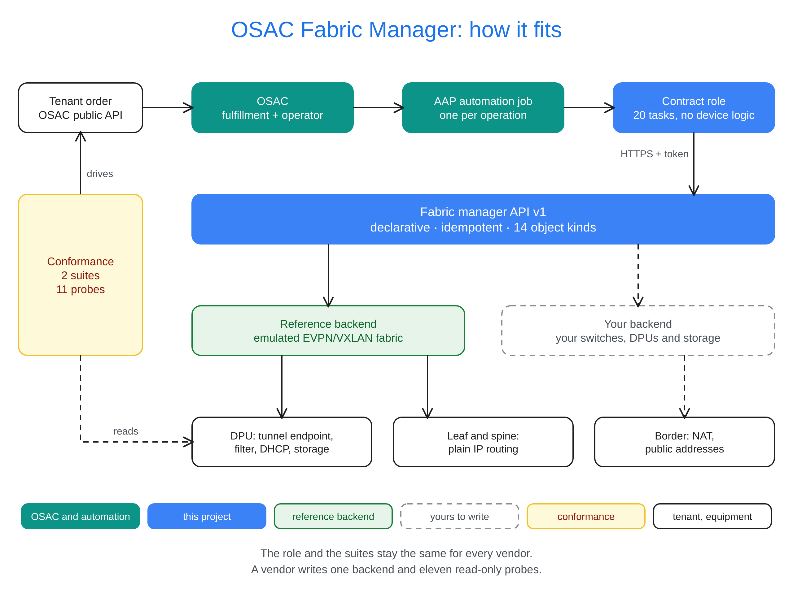

<h1 align="center">OSAC Fabric Manager</h1>

<p align="center">
  <strong>An open fabric manager for the <a href="https://github.com/osac-project">Open Sovereign AI Cloud</a>.</strong><br>
  Bare-metal tenant isolation enforced on the server's DPU, over a BGP EVPN/VXLAN fabric,<br>
  behind a declarative API that any equipment vendor can implement.
</p>

<p align="center">
  <a href="LICENSE"></a>
  <a href="docs/contract.md"></a>
  <a href="docs/api.md"></a>
  <a href="contract/collection"></a>
  
</p>
<p align="center">
  <a href="docs/conformance.md"></a>
  <a href="conformance/reports"></a>
  <a href="docs/conformance-harness.md"></a>
  
  
</p>

---

OSAC orders servers, clusters and networks for tenants, and leaves isolation on the wire to a *fabric manager*
that implements its provider network contract. This project is an open one. It shows that OSAC, driven by
Ansible Automation Platform, extends to whatever network equipment you bring: you implement one API below a
fixed Ansible role, and two end-to-end suites tell you when you are done.

- **DPU-centric.** The tunnel endpoint, the security group, DHCP and storage presentation sit on the server's
  DPU (BlueField-3 style). Leaf and spine switches are plain IP routers with no tenant state.
- **Declarative and idempotent.** `PUT` the desired object, read back `status`. A repeated call is a no-op and a
  delete of something already gone succeeds, so a retrying orchestrator converges.
- **Replaceable below the API.** The contract role and the tests never touch a device. A vendor supplies a
  backend and eleven read-only probes; nothing above the API changes.
- **Tested end to end.** Both suites drive OSAC through its public API as a tenant, check every component on
  the path, tear down, and finish with a leak check.

## How it fits

<p align="center">
  
</p>

<p align="center"><sub>Source: <a href="docs/how-it-fits.excalidraw"><code>docs/how-it-fits.excalidraw</code></a>, editable at <a href="https://excalidraw.com">excalidraw.com</a>.</sub></p>

| Layer | Where | What it is |
|---|---|---|
| Contract role | [`contract/`](contract/collection) | OSAC's twenty network operations as Ansible tasks; each is one or two API calls |
| API v1 | [`docs/api.md`](docs/api.md) | Fourteen object kinds: VPCs, subnets, ACLs, ports, attachments, pools, external IPs, NAT, NAT gateways, load balancers, volumes, volume attachments, CoS policies, fabric domains |
| Reference backend | [`backends/mimic/`](backends/mimic) | One process serving API v1 against a fabric emulated on one machine: FRRouting containers for the border, spines, leaves and DPUs |
| Conformance | [`conformance/`](conformance) | Suite BM (bare metal, 41 steps), Suite CL (hosted cluster, 36 steps), the probe interface |
| Vendor guide | [`vendors/`](vendors/readme.md) | How to bring real equipment: each API object as an obligation on your gear, and the order of proof |

## Try it in a minute

The API's semantics can be checked with no devices and no OSAC. This starts the reference backend in dry-run
mode, plays a full cluster-order sequence through it, and verifies creation, idempotent re-puts, pending then
ready, dependency refusal, cascade and clean deletion:

```bash
git clone https://github.com/dkypuros/osac-fabric-manager.git
cd osac-fabric-manager/backends/mimic/fabd
python3 dryrun_v1.py        # needs only Python 3; ends with "PASS: 0 failed checks"
```

Point the same harness at your own backend with `--target <url> --token <token>`
([docs/conformance-harness.md](docs/conformance-harness.md)).

## Bring your own equipment

1. Read [`docs/api.md`](docs/api.md): what must be true on the equipment when each object is `Ready`.
2. Write a backend that serves API v1 against your switches, DPUs, border and storage. The reference backend in
   [`backends/mimic/fabd/fabd.py`](backends/mimic/fabd/fabd.py) is the worked example.
3. Pass the semantic harness in dry run. It takes seconds per iteration.
4. Fill in the eleven probes in [`conformance/common/probes.py`](conformance/common/probes.py) so the suites can
   read your equipment.
5. Register your fabric manager with OSAC ([`config/hub/`](config/hub)) and run Suite BM, then Suite CL, three
   unattended passes each.

[`vendors/readme.md`](vendors/readme.md) walks through it; [`vendors/dell/`](vendors/dell/readme.md) is a worked
example for BlueField-3, SONiC, iDRAC and PowerStore.

## Status

| | |
|---|---|
| **Proven** | On the reference backend with an emulated fabric (2026-11-07): Suite BM 3 × 41/41, Suite CL 3 × 36/36 unattended, leak checks clean. Reports with per-step timings are in [`conformance/reports/`](conformance/reports). |
| **Automation** | Run under AWX, the upstream of Ansible Automation Platform's automation controller. |
| **Not yet** | A backend for real hardware is not in this repository. The suites carry names and paths from the lab they were written in and need configuring before they run elsewhere. OSAC's own contract conformance tests have not been run against this manager. |
| **Known OSAC issues** | A few upstream defects need workarounds, listed with their removal conditions in [`docs/shims.md`](docs/shims.md). |

## Documentation

| Topic | Document |
|---|---|
| Architecture and the five isolation boundaries | [`docs/architecture.md`](docs/architecture.md), [`docs/sequence-diagrams.pdf`](docs/sequence-diagrams.pdf) |
| The OSAC contract, operation by operation | [`docs/contract.md`](docs/contract.md) |
| Northbound API v1 and how it is built | [`docs/api.md`](docs/api.md), [`docs/api-implementation.md`](docs/api-implementation.md) |
| Backends | [`docs/backends.md`](docs/backends.md) |
| Conformance suites, probes and the harness | [`docs/conformance.md`](docs/conformance.md), [`docs/conformance-harness.md`](docs/conformance-harness.md) |
| Workarounds for upstream issues | [`docs/shims.md`](docs/shims.md) |
| Building the emulated lab | [`docs/from-scratch.md`](docs/from-scratch.md) |
| Names, and which are costly to change | [`docs/naming.md`](docs/naming.md) |

## Repository layout

| Path | Contents |
|---|---|
| `contract/collection/` | Ansible collection `kypuros.fabric` (role `manager`); `tests/run-live.sh` runs the role against a live backend |
| `backends/mimic/fabd/` | `fabd.py`, the reference backend; `dryrun_v1.py`, the semantic harness; `smoke-v1.sh`, a live single-tenant smoke test |
| `backends/mimic/fabric/` | The emulated fabric: `gen.py` generates the containerlab topology and FRRouting configs |
| `backends/mimic/container/` | A container image of the backend in dry-run mode, with an example site configuration |
| `conformance/` | `bm/` and `cl/` suites, `common/` runner and probes, `reports/` |
| `shims/` | Temporary workarounds for upstream OSAC issues, each tied to the issue that removes it |
| `vendors/` | Onboarding guides for real equipment |
| `config/` | The registration object OSAC discovers the fabric manager by; backend configuration and service units |

No secrets are stored in this repository; tokens are read from files outside it.

## License

Apache License 2.0. See [LICENSE](LICENSE).
